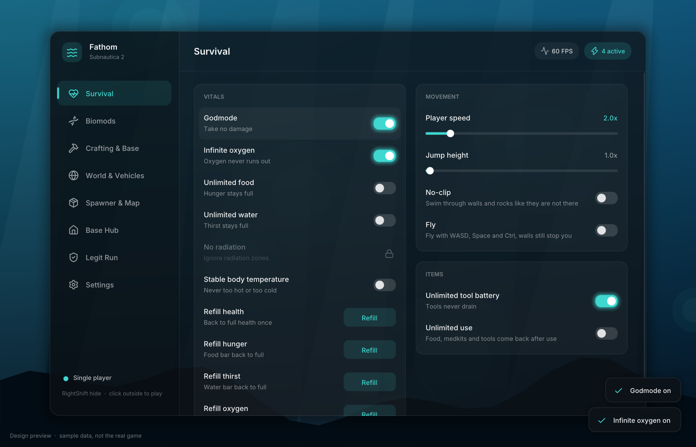

# Fathom

Fathom is a mod menu and game loader with a clean, minimal look, in the style of game trainer apps. The Fathom app shows your games with their Steam artwork. Pick a game, start it and press Inject. The cheat pages for a game only appear once you pick that game.

Game artwork is loaded from your own Steam library cache, or downloaded from Steam when it isn't there. It is kept in the `art` folder next to Fathom and is not part of this repository.

## Games

| Game | Status |
|---|---|
| Subnautica 2 | Ready |
| Borderlands, Borderlands 2, Borderlands 3, Borderlands 4 | Coming soon |
| Cyberpunk 2077 | Coming soon |
| Fallout 4, Fallout: New Vegas | Coming soon |
| Outlast | Coming soon |
| Satisfactory | Coming soon |
| Sons of the Forest, The Forest | Coming soon |
| Subnautica, Subnautica: Below Zero | Coming soon |
| The Last of Us Part I, The Last of Us Part II | Coming soon |

The Subnautica 2 menu has survival cheats, no-clip and fly, a free camera, creature and item ESP, an item spawner, a photo map of the seabed with teleport, base tools, and a Legit Run mode that unlocks things the normal way, step by step.



## Install

1. Download `FathomSetup.exe` from the [latest release](https://github.com/Sniko94pig/Fathom/releases/latest).
2. Run it and press **Install**. Fathom goes into `C:\Users\<you>\Fathom` with a `save-backups` and an `old-builds` folder, and you get a **Fathom** shortcut on your desktop.
3. Open Fathom from the shortcut, pick Subnautica 2, start the game and press **Inject**.
4. In the game, **Right Shift** opens the menu and **End** unloads it.

Windows may say the installer is from an unknown publisher, because it isn't signed. Click **More info**, then **Run anyway**.

Running the installer again updates Fathom to the newest version. The version you had before is kept in `old-builds`.

## Uninstall

Open **Windows Settings > Apps**, find **Fathom** and choose **Uninstall**, or run **Uninstall Fathom** in the Fathom folder. Your save backups stay in the Fathom folder.

## Good to know

- Cheats only work in single player or when you are the host.
- Before anything permanent, like unlocking everything, the menu backs up your saves to `C:\Users\<you>\Fathom\save-backups`.
- Turn the unlock-all switches off before you save if you want to keep your normal progress.
- This is a fan project. It is not made or supported by Unknown Worlds or Krafton.

## Build from source

Needs Visual Studio 2022 with C++ and CMake 3.24 or newer. The libraries are downloaded during the first build.

```
cmake -S . -B build
cmake --build build --config Release --target fathom fathom_launcher fathom_setup
```

This builds `fathom.dll` (the menu), `Fathom.exe` (the launcher) and `FathomSetup.exe` (the installer).

## Thanks

[Dear ImGui](https://github.com/ocornut/imgui), [MinHook](https://github.com/TsudaKageyu/minhook), [kiero](https://github.com/Rebzzel/kiero), [nlohmann/json](https://github.com/nlohmann/json), [stb](https://github.com/nothings/stb), the [Inter](https://rsms.me/inter/) font and [Lucide](https://lucide.dev) icons.
