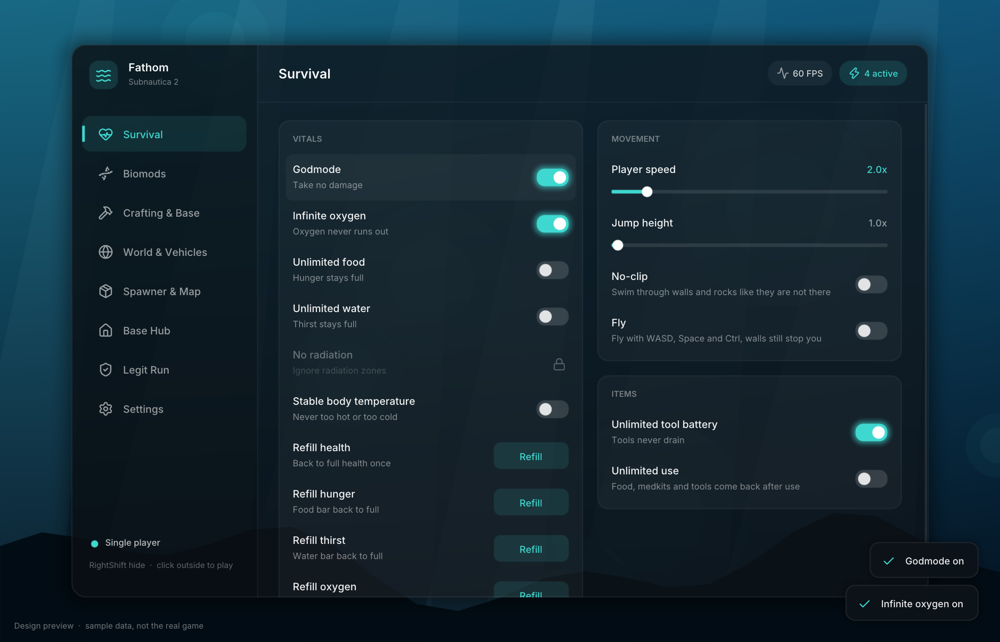

# Subnautica 2

Game mods ready. Everything that belongs to the Subnautica 2 menu is in this folder.

| Folder | What is in it |
|---|---|
| [src/game](src/game) | The menu that runs inside the game (`fathom.dll`): cheats, no-clip, ESP, map, spawner, base tools |
| [src/core](src/core) | The list of cheats and the settings file |
| [src/ui](src/ui) | The menu pages you see in the game and in the Fathom app |
| [src/launcher](src/launcher) | Finding the game, injecting the menu and backing up saves |
| [src/loader](src/loader) | A small helper that loads the menu when the game starts |
| [src/preview](src/preview) | Sample data for the menu pictures |
| [shots](shots) | Pictures of the menu |
| [hub-template](hub-template) | A template for a shared base hub |

